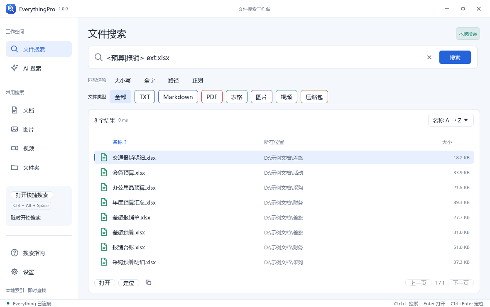
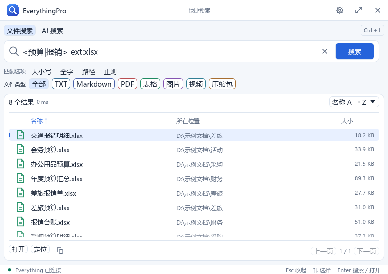
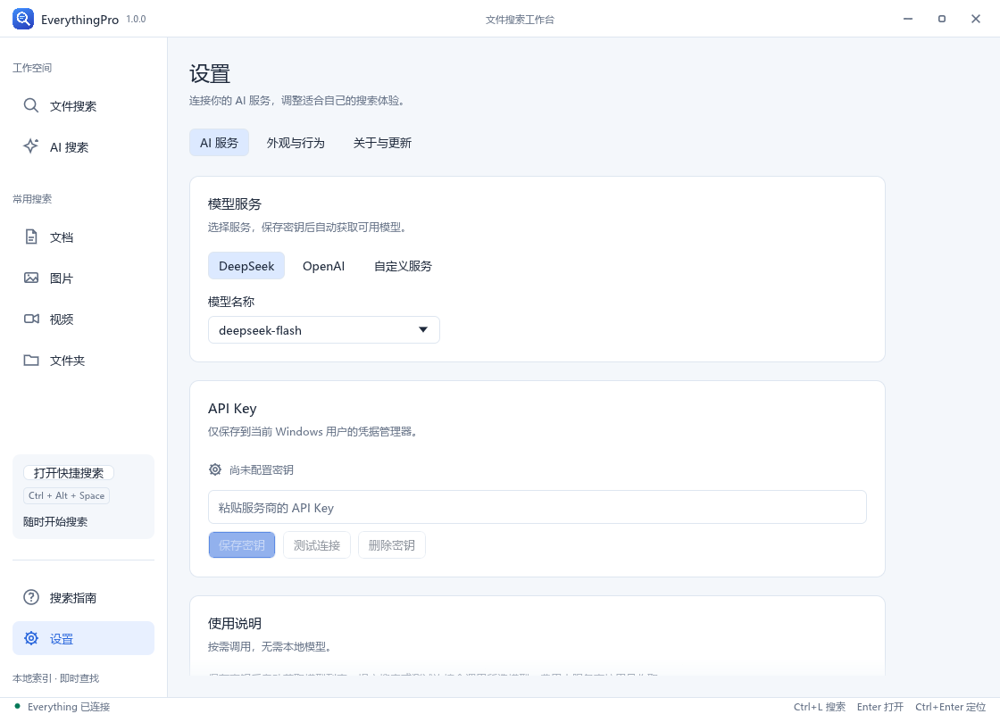
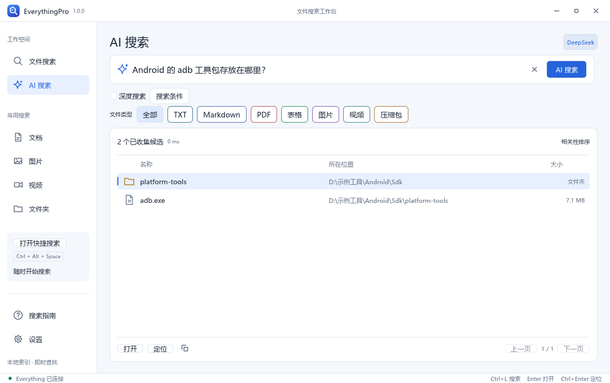

# EverythingPro 用户手册

**适用版本**　1.0.0 正式版　　**适用平台**　Windows 10 / 11 x64

本手册面向在 Windows 上查找本机文件和文件夹的用户。图示取自 1.0.0 的实际界面，文件名、路径和查询结果使用演示数据。首次使用可先完成安装，再尝试「文件搜索」中的第一个示例。

[安装与首次启动](#install) · [文件搜索](#file-search) · [筛选与结果操作](#results) · [快捷搜索与窗口设置](#shortcuts) · [配置 AI 服务](#ai-service) · [自然语言查询与深度搜索](#ai-search) · [应用内更新](#updates) · [故障排查](#troubleshooting)

<a name="install"></a>

## 安装与首次启动

1. 打开最新发行页，展开 **Assets**，下载 `EverythingPro-1.0.0-Setup-x64.exe`。如需指定版本，从全部版本列表进入相应发行页。[最新正式版](https://github.com/dukaijie11/EverythingPro-Releases/releases/latest) · [全部版本下载](https://github.com/dukaijie11/EverythingPro-Releases/releases)
2. 运行安装包，根据 Windows 提示授予安装权限。默认目录为 `C:\Program Files\EverythingPro`。安装阶段需要管理员权限，日常检索可用普通用户身份运行。
3. 阅读安装向导「搜索引擎」页，确认引擎检测结果。安装器会复用已安装且可查询的兼容 Everything 默认实例；其余情况会配置随包提供的 Everything 1.4.1.1032 x64 和独立服务。
4. 从桌面或开始菜单打开 EverythingPro。首次建立索引可能需要一些时间，底部状态变为 **「Everything 已连接」** 后，即可输入文件名验证检索。可先用一个确定存在的本机文件测试。

| 安装环境 | 安装后的行为 |
| --- | --- |
| 已有可用的 Everything 1.4.1 完整版，版本为 1.4.1.1032 或更新的 1.4.1 构建 | 复用原实例。需要查询时，应用可在后台启动已有客户端。 |
| 无可用引擎，或仅安装 Lite / 1.5 测试版 | 在应用目录部署内置引擎，配置独立的 `Everything (EverythingPro)` 服务。 |

索引主要面向本机 NTFS 卷。其他文件系统、网络目录以及受权限限制的位置，能否检索取决于 Everything 的索引范围和访问权限。

<a name="file-search"></a>

## 文件搜索

选择左侧 **「文件搜索」**。输入文件名片段时，结果会随输入更新。记得扩展名、修改日期或所在目录时，可把多个条件写在同一行。在左侧 **「搜索指南」** 点击示例，也可以直接执行相应查询。



**示例一　按文件类型和日期查找。** 输入 `ext:pdf dm:today`，可列出今天修改的 PDF。如果结果为空，先移除 `dm:today`。若此时能看到文件，说明原先的修改日期条件缩小了范围。

**示例二　名称满足其一，同时限定扩展名。** 将下一行完整复制到搜索框，可查找名称包含“预算”或“报销”的 Excel 工作簿。

```text
<预算|报销> ext:xlsx
```

| 查询目标 | 可直接使用的表达式 |
| --- | --- |
| 扩展名为 JPG 或 PNG 的图片 | `ext:jpg;png` |
| 大于 100 MB 的 MP4 或 MKV 文件 | `ext:mp4;mkv size:>100mb` |
| 名称含有 platform-tools 的文件夹 | `folder: platform-tools` |
| 文本文件，排除名称中含有 temp 的条目 | `file: ext:txt !temp` |
| 名称以 .rs 结尾的条目 | `regex:\.rs$` |

普通查询中，空格表示条件同时满足，竖线表示满足任一条件，感叹号表示排除。目录名包含空格时请加双引号，例如 `"D:\Project Files\" ext:pdf`；将示例目录换成实际路径。查询框下的 **「大小写」「全字」「路径」「正则」** 可分别控制大小写、完整词匹配、匹配范围和正则表达式模式。若普通关键词意外返回空结果，先检查这四个开关。

常规查询主要使用名称、路径和文件属性。如需匹配文件正文，可在「文件搜索」中使用 Everything 的 `content:` 语法。读取和匹配正文会增加耗时，宜同时限定目录或文件类型。[Everything 官方查询语法](https://www.voidtools.com/support/everything/searching/)

<a name="results"></a>

## 筛选与结果操作

**文件类型。** 点击查询框下方的 TXT、Markdown、PDF 等按钮可直接筛选。可同时选中多个类型，结果只要符合其中一种即可；点 **「全部」** 清除类型限制。窄窗口中部分按钮会收进「更多」。文件搜索与 AI 搜索分别保留各自的类型选择。

**自定义常用类型。** 打开 **「设置 → 外观与行为 → 常用文件类型 → 编辑文件类型」**，点「添加类型」，填写名称和扩展名。例如将名称设为“配置文件”，扩展名填 `toml;yaml;yml`。点击色块选择按钮颜色，用上下箭头调整顺序，最后点「保存」。类型名称需唯一。

| 操作 | 方法 |
| --- | --- |
| 排序 | 点击「名称」「所在位置」或「大小」列头，再点同一列头反转顺序。文件搜索对全部匹配项排序后分页。 |
| 打开条目 | 双击结果，或选中后点击「打开」。打开文件时使用 Windows 对应的默认应用。 |
| 在资源管理器中定位 | 选中结果，点击「定位」或按 `Ctrl + Enter`。 |
| 复制完整路径 | 右键结果选择「复制完整路径」，或选中后按 `Ctrl + Shift + C`。 |
| 查看更多结果 | 使用结果区域右下角的上一页、下一页按钮。切换到另一种搜索模式后，原页保留输入与结果。 |

<a name="shortcuts"></a>

## 快捷搜索与窗口设置

在其他应用工作时，按 **`Ctrl + Alt + Space`** 可唤出快捷搜索，直接输入条件。弹窗上方可切换「文件搜索」和「AI 搜索」，按 `Esc` 收起。主窗口和快捷窗口都支持拖动边缘调整大小，并分别记住尺寸。



| 快捷键 | 作用 |
| --- | --- |
| `Ctrl + Alt + Space` | 全局唤出或收起快捷搜索。 |
| `Ctrl + L` | 将焦点移到当前搜索框。 |
| `↑` / `↓` | 在结果列表中移动选择。 |
| `Enter` | 在 AI 输入框中提交查询；在结果列表中打开选中项。 |
| `Ctrl + Enter` | 在资源管理器中定位选中项。 |
| `Ctrl + Shift + C` | 复制选中项的完整路径。 |
| `F5` | 刷新本地查询；AI 页复用已有查询条件。 |
| `Esc` | 收起搜索窗口。 |

要修改**全局唤醒键**，进入「设置 → 外观与行为 → 快捷搜索」，点击「更改快捷键」，按下新组合。可用 Ctrl、Alt、Shift 搭配字母、数字、空格或功能键。注册失败时请换一组组合键；点击「恢复默认」可恢复初始设置。

如需登录后直接使用快捷搜索，在同页的「窗口与托盘」启用 **「登录 Windows 后自动启动到托盘」**。若启用了「关闭窗口后保留托盘与全局快捷键」，关闭主窗口后仍可从托盘或热键唤出。要彻底退出，可在托盘菜单选择「退出 EverythingPro」，或进入「设置 → 关于与更新」点击「退出 EverythingPro」。

<a name="ai-service"></a>

## 配置 AI 服务

执行自然语言查询需要服务商提供的 API Key、可用模型和网络连接。普通文件搜索可独立使用。



1. 打开 **「设置 → AI 服务」**。也可从 AI 搜索页点击「配置 API Key」直达设置。
2. 在「模型服务」选择 **DeepSeek、OpenAI 或自定义服务**。选择官方服务时使用内置服务地址。选择自定义服务时，填写服务商给出的 **Base URL**，并选择其支持的 **Chat Completions** 或 **Responses** 协议。例如服务商给出的兼容接口根地址为 `https://gateway.example/v1`，就在此填写这个根地址，应用会自行追加模型列表和请求路径。
3. 在「API Key」区域粘贴密钥并点击 **「保存密钥」**。模型列表会自动获取并缓存。在「模型名称」选择账号可用的模型。如果网关不提供模型列表，可选择「手动填写…」，输入服务商提供的模型标识。
4. 点击 **「测试连接」** 查看结果。连接测试会调用所选模型，计费取决于服务商。若提示认证或权限错误，分别核对密钥、模型权限及自定义服务地址。
5. 需要更换密钥时输入新密钥并再次保存。需要移除密钥时，选择相应服务后点击「删除密钥」。密钥存储于当前 Windows 用户的凭据管理器中。

建议使用服务商提供的 HTTPS 地址。自定义网关也接受 HTTP，通过 HTTP 发送的密钥和请求内容缺少传输加密。

<a name="ai-search"></a>

## 自然语言查询与深度搜索

### 提交查询并核对结果

1. 选择 **「AI 搜索」**，输入记得的用途、名称片段、类型或位置，点击「AI 搜索」。
2. 模型将描述转换为检索条件，可关联名称、别名和工具包名称。应用在本机执行查询，合并重复路径，按相关性显示候选项。
3. 例如输入「Android 的 adb 工具包存放在哪里？」。候选可能包含 `platform-tools` 目录和 `adb.exe`。找到目录后可直接定位；只想查看某种文件时，可点击文件类型筛选。
4. 如果范围过宽，打开 **「搜索条件」** 查看解释和表达式。选择「修改条件」会将当前表达式带入文件搜索；选择「复制表达式」可自行保存。对候选按列排序后，可点击「恢复相关性排序」。



描述中尽量给出能在文件名或路径上核对的线索。例如「上周修改过的报销 PDF」兼具日期、主题和类型；「下载目录里名字带培训的演示文稿」兼具位置和用途。若需要在文件正文中查找具体语句，请使用前述文件搜索的正文检索语法。

### 何时启用深度搜索

普通 AI 搜索一次最多生成 5 组本地查询。若目标可能有别名、首轮结果与预期相差较大，可在 **AI 搜索页** 勾选「深度搜索」。首次启用时，界面会列出接收服务和拟发送的信息，选择「允许并记住」后才能继续；也可选择「使用普通搜索」。

| 操作 | 向所选 AI 服务发送的信息 |
| --- | --- |
| 普通 AI 查询 | 用户输入的描述、当前日期和用于生成检索条件的规则。用户在描述中主动写入的路径会随描述一起发送。 |
| 已授权的深度搜索 | 后续轮次还可发送最多 20 个候选的名称、文件或目录标记、大小，以及候选总数和已搜索的名称片段。候选反馈不包含完整路径或文件正文。 |

单次深度搜索最多调用模型 3 轮、执行 15 组本地查询。可在查询过程中点「取消」，已找到的候选会保留。需要撤回授权时，打开「搜索条件」，选择「撤回发送文件名的授权」。两种搜索模式均支持切页后继续检索；对已返回结果切换文件类型不会额外调用模型。

<a name="updates"></a>

## 应用内更新

应用启动时会在后台检查 GitHub 上的最新正式版本。以托盘方式启动时，可在打开主窗口后查看更新提示。手动检查入口为 **「设置 → 关于与更新 → 检查更新」**。


1. 发现更高版本后，可选择「稍后」，或点击 **「立即更新并重启」**。更新窗口显示下载进度。
2. 下载完成后，应用用内置发布公钥验证安装包签名。Windows 可能要求管理员授权。取消下载或拒绝授权时，可继续使用当前版本。
3. 确认授权后，更新程序退出旧进程，在原安装目录替换程序文件，然后以原用户身份启动新版本。无需逐页操作安装向导。
4. 重启后进入「关于与更新」核对版本号，再执行一次「检查更新」。当前已是最新版本时，界面会显示「当前没有可用更新」。

**手动安装或修复。** 在发行页下载相应版本的完整安装包，沿用原安装目录运行。用于手动核验的 `.exe.sha256` 和用于应用内更新的 `.exe.sig` 均与同版安装包配套。可在 PowerShell 中执行下列命令，将输出的 SHA-256 与校验文件中的值逐位比较。

```powershell
Get-FileHash -LiteralPath ".\EverythingPro-1.0.0-Setup-x64.exe" -Algorithm SHA256
```

<a name="troubleshooting"></a>

## 故障排查与卸载

| 现象 | 处理方法 |
| --- | --- |
| 首次使用时长时间显示引擎准备中 | 等待首次索引完成，再查找一个已知存在的本机文件。若界面提示连接失败，点「重新连接 Everything」。 |
| 原来能搜索，移除或更改原版 Everything 后无法连接 | 在原安装目录重新运行 EverythingPro 完整安装包，使安装器重新检测并配置引擎。 |
| 文件存在但查不到 | 点「全部」清除类型限制，检查「大小写」「全字」「路径」「正则」开关。先用文件名片段检索，再逐个加回目录、日期和类型条件。仍无结果时核对目标位置是否纳入 Everything 索引。 |
| AI 模型列表为空或连接测试失败 | 确认已保存密钥，并核对 Base URL、协议和模型权限。网关缺少模型列表接口时手动填写模型标识，重新测试连接。 |
| 全局快捷键无响应 | 确认应用仍在运行，先尝试主窗口中的「打开快捷搜索」。如提示按键已被占用，在「设置 → 外观与行为」重新绑定全局唤醒键。 |
| 检查更新提示网络错误，或签名验证失败 | 确认可以访问 GitHub 发行页后重试。仍然失败时，从对应正式版发行页手动下载安装包并核对 SHA-256。 |
| 点击关闭后仍有托盘图标 | 这是「关闭窗口后保留托盘与全局快捷键」的行为。需要结束程序时使用托盘菜单中的「退出 EverythingPro」。 |

**卸载。** 在 Windows「设置 → 应用」中找到 EverythingPro 并执行卸载。卸载程序移除本应用拥有的引擎服务，复用的外部 Everything 仍由用户管理。用户设置和索引缓存保留在 `%LOCALAPPDATA%\EverythingPro`，已保存的 API Key 保留在 Windows 凭据管理器中。若需要同时清除密钥，可先在「设置 → AI 服务」删除对应密钥，再卸载应用。

提交问题时，请注明 Windows 版本、EverythingPro 版本、引擎模式、复现步骤以及界面提示。截图中的 API Key、私人文件名和路径请先遮盖。[提交问题](https://github.com/dukaijie11/EverythingPro-Releases/issues)
